# Kian Anbarestani

**Senior Software Engineer | Python Backend • Distributed Systems • AI Infrastructure • Cloud**

---

## About Me

Senior Software Engineer with nearly 6 years of experience architecting scalable Python applications, distributed processing systems, and enterprise-grade backend platforms.

Specialized in **Python, FastAPI, Django, PostgreSQL, Apache Kafka, microservices, and event-driven architectures**, with hands-on experience building high-performance backend infrastructure for AI-powered video surveillance, real-time streaming, multi-tenant SaaS, and enterprise applications.

My engineering focus includes:

- **Distributed Systems:** Designing fault-tolerant, asynchronous, and event-driven backend architectures.
- **Performance Engineering:** Optimizing PostgreSQL queries, API latency, application startup, and resource utilization.
- **AI & Video Infrastructure:** Integrating NVIDIA DeepStream, TensorRT, Kafka, WebRTC, and real-time GPU inference pipelines.
- **Cloud & Infrastructure:** Building scalable containerized systems using Docker, Kubernetes, AWS, GCP, and Terraform.
- **Security & Reliability:** Implementing secure authentication, encryption, observability, and resilient production systems.

I enjoy solving complex engineering problems, eliminating performance bottlenecks, and building maintainable systems that scale efficiently.

---

## Technical Skills

### Backend & Languages
Python • SQL • FastAPI • Django • Django REST Framework • Flask • Peewee ORM • Odoo

### Distributed Systems & Messaging
Apache Kafka • RabbitMQ • Celery • Redis • Microservices • Event-Driven Architecture • Asynchronous Processing

### Databases & Storage
PostgreSQL • MySQL • MongoDB • SQL Server • Oracle • Qdrant • MinIO • S3-Compatible Object Storage

### Cloud & DevOps
Docker • Docker Compose • Kubernetes • AWS (ECS, Lambda, RDS) • GCP • Terraform • Jenkins • Ansible • Linux • Git

### AI & Video Infrastructure
NVIDIA DeepStream • TensorRT • GStreamer • CUDA • ONNX • go2rtc • WebRTC • RTSP • FFmpeg • MSE

### Architecture & API Design
Distributed Systems • Clean Architecture • Modular Monoliths • Multi-Tenant SaaS • RESTful APIs • gRPC • System Design

### Security, Testing & Observability
OAuth 2.0 • OIDC • AES-256-GCM • Grafana • Splunk • Zabbix • Trivy • Gitleaks • Ruff • BDD/Cucumber

---

## Selected Engineering Impact

- **9x Faster Application Startup:** Re-architected background processing and daemon orchestration, reducing cold-boot time from approximately 90 seconds to 10 seconds.
- **20,000x Faster Database Lookups:** Optimized PostgreSQL retention queries and indexing, reducing benchmarked lookup latency from 772 ms to 0.038 ms.
- **85.5% Lower Processing Latency:** Optimized Kafka-driven GPU inference integrations using bounded queues, incremental streams, and workload isolation.
- **Real-Time Video Infrastructure:** Built low-latency streaming architectures using go2rtc, WebRTC, RTSP, and FFmpeg with resilient playback fallback.
- **Scalable AI Processing:** Designed distributed facial recognition workflows using Kafka partition routing, idempotent consumers, and camera-level scheduling.
- **Enterprise-Scale Platforms:** Engineered backend systems supporting 50,000+ active users, high-traffic applications, and multi-tenant enterprise services.
- **Production Security:** Implemented encryption at rest, centralized identity management, automated security scanning, and enterprise security compliance controls.

---

## Current Focus

- High-performance Python backend engineering
- Distributed systems and event-driven architectures
- AI inference infrastructure and real-time video processing
- PostgreSQL performance and database scalability
- Cloud-native infrastructure and production reliability
- Secure, scalable enterprise software architecture

---

## Education

**M.Sc. in Information Technology — Information Systems Management**  
Shiraz University

**B.Sc. in Biomedical Engineering**  
University of Isfahan

---

## GitHub Stats

  
  

---

<!--START:projects-->
## 🔥 Latest Repositories I Contributed To

* [celery/celery](https://github.com/celery/celery) – Distributed Task Queue (development branch)  
  ⭐ 29056 | 🕒 Updated: 2026-10-25

<!--END:projects-->
